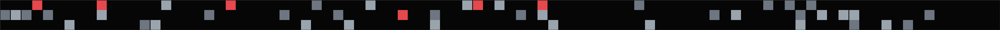

 

 

<samp>01000001 01000100 01001001 01010100 01011001 01000001&nbsp;//&nbsp;signal acquired</samp>

 

<!-- ==================== WHO I AM ==================== -->

 

<samp>Hey, I'm Aditya — a Ranchi-based full stack engineer who builds the parts of the stack that have to survive retries, load spikes and 3 a.m. deploys. CSE '27 at IIIT Ranchi — shipping edtech by day, breaking and rebuilding my own systems by night.</samp>

<samp>I like knowing <i>why</i> it works, not just that it works. Every line I ship, I can explain.</samp>

 

<samp>status: building_edtech_by_day &nbsp;·&nbsp; base: IIIT Ranchi &nbsp;·&nbsp; class_of: '27 &nbsp;·&nbsp; mode: nocturnal</samp>

  

<!-- ==================== WHAT I'M BUILDING ==================== -->

 

<samp><b>REC_01 · LEDGER</b> — financial backend</samp> 
<i>Moves money over HTTP without ever moving it twice — idempotency on every write path, three roles of RBAC, and k6 hammering it with 200 concurrent users for sport.</i>

<samp>stack: node · express · mongo · jwt · k6 &nbsp;|&nbsp; status: in_production</samp>

  

<samp><b>REC_02 · DEVTINDER</b> — developer networking platform</samp> 
<i>Match-and-chat for developers where the chat actually feels live — WebSockets end to end, the premium loop handled by Razorpay, and a React layer that re-renders only when it should.</i>

<samp>stack: react · node · socket.io · razorpay · ses &nbsp;|&nbsp; status: in_production</samp>

  

<samp><b>REC_03 · DISTRIBUTED-TICKET-SERVICE</b> — event-driven backend</samp> 
<i>React throws the ticket, Kafka carries it, workers do the work, the browser finds out instantly. 10k+ workflows a day — all delivered exactly once.</i>

<samp>stack: react · kafka · docker · nginx · socket.io &nbsp;|&nbsp; status: in_production</samp>

  

<!-- ==================== VISION ==================== -->

 

<samp>My goal is to build systems people can trust at 3 a.m. — money that moves exactly once, chats that feel live, tickets that never double-book. The boring kind of reliable.</samp>

<samp>Reliability first, cleverness second — the skyline is only as good as the ground it stands on.</samp>

  

<!-- ==================== BEYOND CODE ==================== -->

 

<samp>UI/UX lead at GDG IIIT Ranchi — running campus-wide creative events. Teardowns over tutorials, logs over vibes. Usually awake past midnight — that's when the city grows.</samp>

 

<!-- ==================== LINKS ==================== -->

<table>
  <thead>
    <tr>
      <th align="center"><samp>LINKEDIN</samp></th>
      <th align="center"><samp>GITHUB</samp></th>
      <th align="center"><samp>GMAIL</samp></th>
    </tr>
  </thead>
  <tbody>
    <tr>
      <td align="center"></td>
      <td align="center"></td>
      <td align="center"></td>
    </tr>
  </tbody>
</table>

 

<!-- ==================== CONTRIBUTION CITY ==================== -->

 

<samp>every block = one day &nbsp;·&nbsp; height = commits &nbsp;·&nbsp; rebuilt nightly @ 00:10 IST &nbsp;·&nbsp; theme: night_view</samp>

 

  
  &nbsp;&nbsp;
  

 

<!-- ==================== SKILL SET ==================== -->

 

<table>
  <tr>
    <td align="center"> <samp>JavaScript</samp></td>
    <td align="center"> <samp>TypeScript</samp></td>
    <td align="center"> <samp>React</samp></td>
    <td align="center"> <samp>Node.js</samp></td>
    <td align="center"> <samp>MongoDB</samp></td>
    <td align="center"> <samp>Postgres</samp></td>
    <td align="center"> <samp>Prisma</samp></td>
    <td align="center"> <samp>Kafka</samp></td>
  </tr>
  <tr>
    <td align="center"> <samp>Docker</samp></td>
    <td align="center"> <samp>K8s</samp></td>
    <td align="center"> <samp>Nginx</samp></td>
    <td align="center"> <samp>Go</samp></td>
    <td align="center"> <samp>Git</samp></td>
    <td align="center"> <samp>Linux</samp></td>
    <td align="center"> <samp>Tailwind</samp></td>
    <td align="center"> <samp>Figma</samp></td>
  </tr>
</table>

<samp>also_in_rotation: express · socket.io · fastify · k6 · aws_ses · postman</samp>

  

<!-- ==================== FOOTER ==================== -->

 

<samp>save the skyline: <kbd>ctrl</kbd> + <kbd>s</kbd> &nbsp;//&nbsp; 01001110 01101111 01100011 01110100 &nbsp;//&nbsp; end of transmission</samp>

