

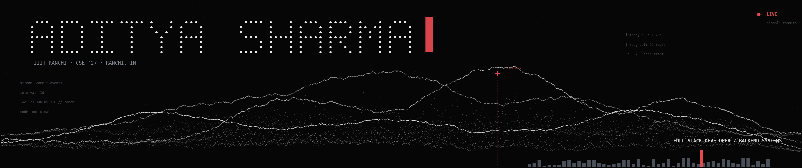
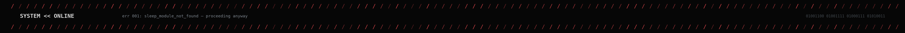

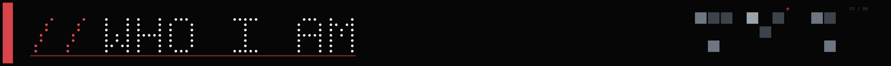
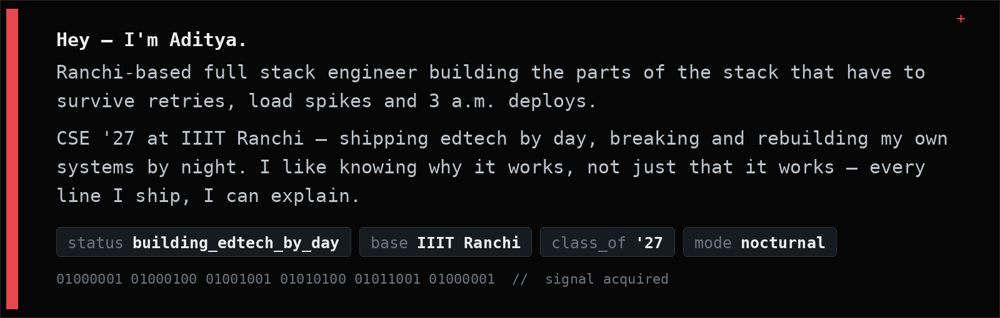

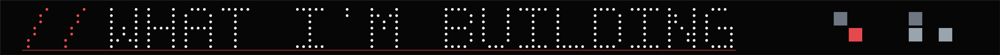
<a href="https://github.com/Mechtech001/Ledger">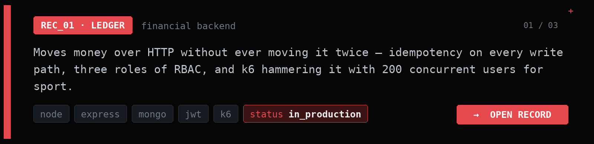</a>
<a href="https://github.com/Mechtech001/DevTinder">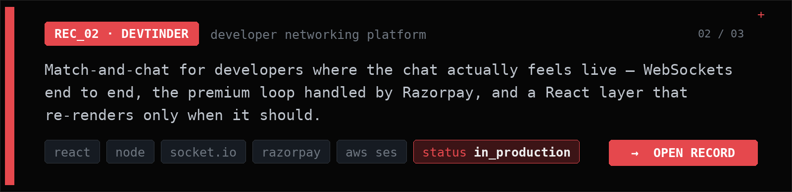</a>
<a href="https://github.com/Mechtech001/distributed-ticket-service">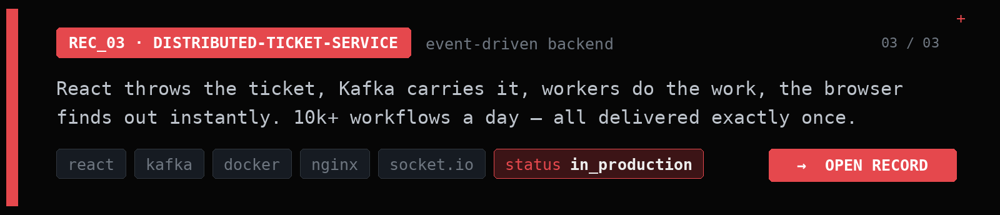</a>

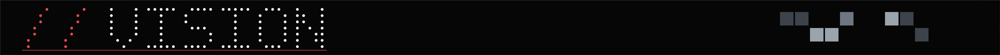
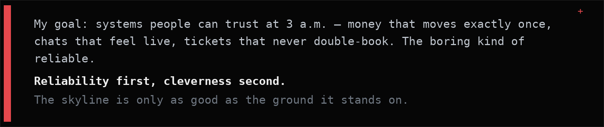

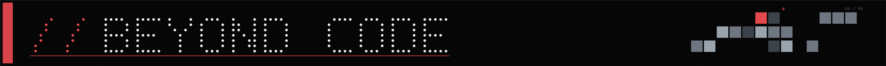
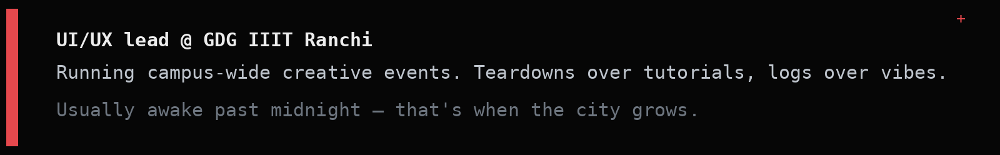

<a href="https://www.linkedin.com/in/aditya-sharma-516491321">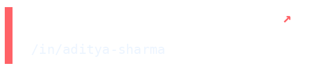</a><a href="https://github.com/Mechtech001">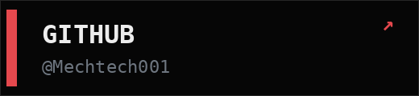</a>

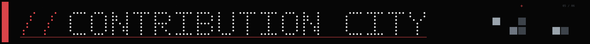
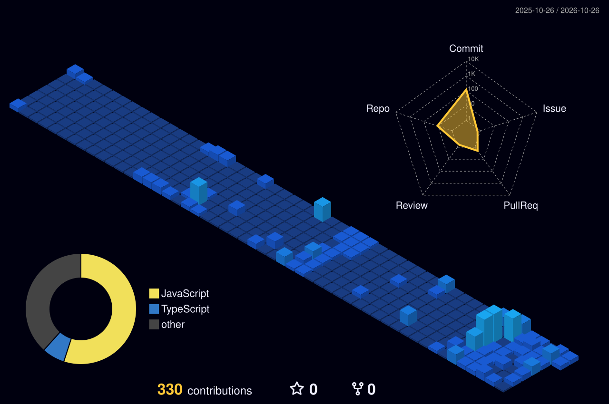
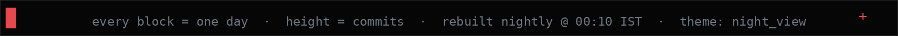

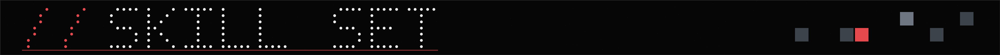
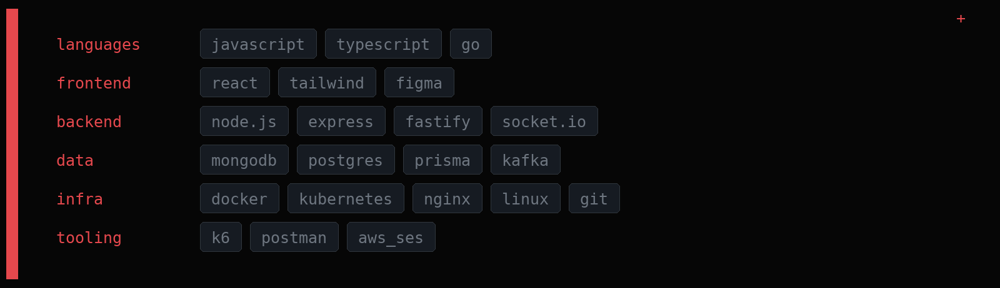

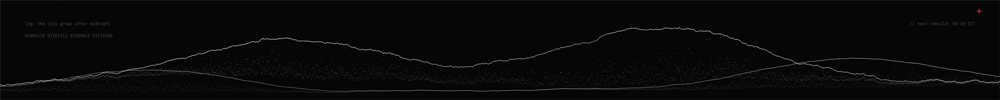

 

